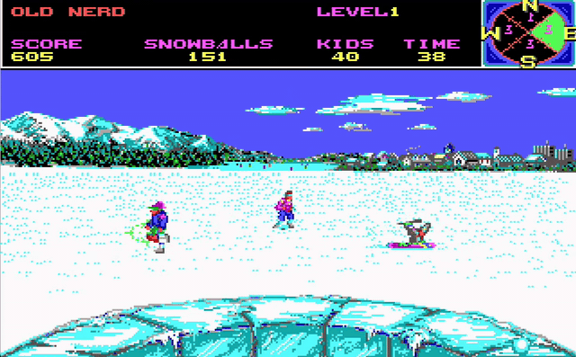

# Snowball War — a REA-driven reconstruction of a Ski or Die minigame

An independent, playable reconstruction of the **Snowball War** minigame
("snowball blast") from the DOS version of *Ski or Die* (Electronic Arts).
The game is written in Rust and uses SDL2. The project demonstrates **REA**
(Reverse Engineer Anything), an AI-assisted workflow for reverse
engineering. The workflow analyzes the shipped binary, recovers the
gameplay rules with evidence, records them, and rebuilds the minigame from
that specification.

Only Snowball War is investigated and rebuilt. The other events and the
original engine are out of scope.



## Quick start — download the game, prepare the assets, play

1. **Download the original DOS release** that you own:

   <https://www.abandonwaredos.com/abandonware-game.php?gid=1074>

   **Note:** The copy used for the analysis matches this listing.

2. **Extract the archive into `Ski_Or_Die/`:**

   ```text
   Ski_Or_Die/           <- unzip the release here (any sub-directory layout works)
   ```

3. **Build the runtime assets** (Python 3, standard library only, nothing
   from the game is committed):

   ```bash
   python3 tools/extract/build_assets.py Ski_Or_Die assets --preview
   ```

4. **Build and play:**

   ```bash
   cargo run --release
   ```

You need these tools: Rust stable with Cargo, the SDL2 development library
(`libsdl2-dev`, pkg-config name `sdl2`), and Python 3. See [Build](#build)
for details.

The extractor works by itself. It does these tasks:

* It finds the game files in any directory layout.
* It undoes the EXEPACK compression of the game executable.
* It decodes the LZSS containers and the image formats.
* It recovers the 8x8 HUD font from inside the executable.

The extractor writes `assets/snowball.pack` and the byte-exact audio data
in `assets/audio/`. The tool prints the SHA-256 of the pack. For the
release used here the value is `1a45a848…100a` and the size is
1 079 163 bytes. The `--preview` option writes PNG/PPM preview images to
`assets/preview/`.

## Why Snowball War is the reconstruction target

*Ski or Die* ships several events inside one shared executable. One event
is enough to demonstrate the workflow. Snowball War is the best target
because it gives the most gameplay for the least reverse-engineering
effort:

* **Bounded scope.** Snowball War is one event module inside the shared
  executable. It has its own entry point, frame loop, HUD, and round rules.
  The whole minigame can be recovered without work on the other events or
  the shared engine.
* **Rich mechanics with bounded size.** The minigame has 8-way
  accelerating movement, scripted targets, ballistic snowball arcs, hit
  resolution, an ammo and score economy, levels, timers, and a practice
  mode. The mechanics are rich enough to make the recovered specification
  a meaningful result. The module is still small enough to complete and
  test.
* **Readable evidence to start from.** The binary contains readable event
  strings: `snowfight competition`, `snowballs   kids`, and
  `bonus for clearing level`. The analysis starts from these strings.
  They find the module and its data before any code is understood.

## The original executable (reference only — not committed)

| Item | Value |
|---|---|
| Directory | `Ski_Or_Die/` (kept in this working copy, listed in `.gitignore`) |
| Analyzed file | `SKIEGA` — the 16-colour EGA build, plain `MS-DOS executable, MZ` |
| SHA-256 | `6638bd4d4e6e43136d1fcf69b800baa4ad5a1c7850b2f0eed4607d46fdcead70` |
| Compression | EXEPACK (stub at `CS:0x0CA6:0x0012`, message `!Packed file is corrupt`) |
| Unpacked image | 0xF7C0 bytes, SHA-256 `79ee524c51ebf424c8f94acbd48396159b77c4b87fed637b710f8a3a6f3e87d3` |

The executable is compressed with EXEPACK, so the analysis needed a
faithful unpack step first. The shipped file is never modified. The
original game, its data files, its art, and its audio stay out of the
repository.

## How REA was used

1. `rea doctor` showed that DOS MZ targets need the REA Ghidra path, the
   "Ghidra 16-bit real-mode adapter". Hopper is the other configured
   provider, and it rejects DOS formats.
2. Ghidra **12.1.4** and JDK **21** were installed. `rea doctor` then
   reported all Ghidra checks healthy: `ghidra-version`,
   `ghidra-headless`, and `ghidra-java`.
3. The EXEPACK stub was replayed to make an unpacked load image. A minimal
   MZ header wrapped the image. REA then checked it with
   `rea inspect-native-load-image --provider ghidra` and reported
   `status: verified`, entry `0x100C5`, language `x86:LE:16:Real Mode`,
   load segment `0x1000`.
4. The search for functions used the REA caller-declared seed mechanism
   (`REA_GHIDRA_SEED_FILE`). Event modules are reachable only through
   indirect dispatch, so auto-analysis cannot find them. REA reported
   **559 seeded functions created, 4494 code seeds decoded, 0 failures**.
   REA flags these results as caller assertions.
5. The analysis recovered the behavior with `rea trace`, `rea function`,
   and `rea search`. The commands ran over the Snowball War module (entry
   `0x3B0E`, frame loop `0x3B53`, HUD `0x3DF0`, movement `0x3FDF`, spawner
   `0x427D`, script engine `0x4338`, snowball creation `0x448F`, throw and
   hit `0x47C1`/`0x48B0`, time tick `0x4A49`, object step `0x64EC`, input
   `0x6C78`/`0x6D0C`).

The opencode MCP server for this session started before `GHIDRA_INSTALL_DIR`
existed. Every analysis call therefore ran through the **REA CLI**, which
uses the same package and providers. The opencode config now carries the
Ghidra environment for future sessions. See
[`docs/reverse-engineering-notes.md`](docs/reverse-engineering-notes.md)
for the full details, commands, and evidence excerpts.

## Original assets (extracted and used)

`tools/extract/build_assets.py` extracts the graphics and audio from the
shipped data files. It decodes the LZSS containers and the three recovered
image formats. The reconstruction uses the results:

| Asset | Source | Notes |
|---|---|---|
| `assets/snowball.pack` | written by the extractor | everything the Rust game loads at runtime |
| `assets/audio/*` | tunes + `*.SMB` banks | byte-exact audio data (playback not implemented yet) |
| `assets/preview/arena.png` (`--preview`) | `SNOWFORT.LZW` | 320x200 Snowball War arena |
| `assets/preview/sprites.png` (`--preview`) | `SFFBM.LZW` | 165 sprites: kids, snowballs, cursor, specials |
| `assets/preview/overlay.png` (`--preview`) | `SFSHP.LZW` | per-team scenery bands and compass wedges |
| font (inside the pack) | executable DS:0x6728 | the game's 8x8 HUD font |

`docs/assets.md` has the full findings. The short version:

* Sprite records are stored **mirrored horizontally**. A **per-frame mirror
  byte** tells the blitter (`0x177E7`, flag from `[SI+0xE]`) when to apply
  the mirror.
* Colour index 0 is transparent.
* Third-party tool output looked **obfuscated** because its BMP writer
  added an extra vertical flip.
* The HUD font lives inside the executable, so the HUD text is
  pixel-identical.
* The startup copy protection is a code-wheel question (`CPSHP.LZW`,
  "please enter number in hole"). It is not asset encryption.

Render one frame without a window to compare it with the original screen:

```bash
cargo run --example frame -- 300 frame.ppm   # headless render for comparison
```

## What was recovered

The following rules are **confirmed** by code. See the behavior spec for
the addresses:

* **Arena**: the playfield is 300×200. The player is clamped to
  `x∈[0,299]` and `y∈[53,199]` and starts at (150,150). Objects clamp at
  `x≤319` and `y≤199`.
* **Controls**: the keypad and arrow keys move the throwing **cursor** in
  8 directions. **Enter** starts the round and throws a snowball at the
  cursor. **Right Shift + a cardinal key** selects one of the four kid
  teams (0…3). The compass shows the four counts.
* **Movement acceleration**: the speed grows 2 → 4 → 6 px/frame. The rule
  adds 40 per frame and caps the high byte at 2. The speed resets at once
  when the key is released.
* **Kids**: every participant spawns kids every 90 frames from a shared
  credit budget. The four kid slots take their scripts from 10-record
  lists in the original tables. Four kid types appear with odds of
  26/25/30/20 % and scores of 100/75/50/25 points. The types use
  scripted walk, throw, and death behavior. The despawn thresholds are
  305/299/291.
* **Snowballs**: a kid creates a snowball on throw-animation frame 5. Each
  participant has a 3-slot pool. The snowball flies a **scripted
  ballistic arc** that rises and then falls (19/17/13 frames). It expires
  when its script ends. Every throw adds 6 to the meter.
* **Player throw**: the throw cadence is 5 frames. A throw costs one
  snowball and is free while `unlimited` is active. The hit test uses the
  point `(x+9, y−8)` against the queued objects. Each type has its own
  score and death effects.
* **Rounds**: the level target is 50 + bonus. Every clear adds `+25`
  bonus and `score += 1000 + snowballs`. The timer has 60 units and ticks
  every 41 frames. A time-out converts the remaining snowballs into score.
  Practice mode ends at meter 0x0F.
* **Specials**: a roaming object appears every 400 frames (6 types).
  Pickups appear every 600 frames: snowball +100, meter −256, or
  `unlimited` for 400 frames. The game gives +10 ammo every 50 frames
  while the player has no snowballs.

The following items are **uncertain** or **approximated**:

* The `[0x75e3]` gate is implemented exactly. Only the selected team's
  kids are visible and hittable, so the player switches teams to reach the
  level target (see the spec, §9).
* The hit boxes use the real extracted sprite dimensions.
* The frame rate is an approximation: the reconstruction uses 35 Hz.
* The PRNG algorithm is an approximation: the reconstruction uses a seeded
  xorshift32.
* The pause and exit keys are approximations: P and Esc.
* The fifth kid slot is disabled in the shipped data, so the game uses
  four slots.
* The audio data is extracted, but playback is not implemented.

## Build

You need these tools on Linux:

* Rust stable (tested with 1.93) and Cargo
* The SDL2 development library: `libsdl2-dev` (pkg-config name `sdl2`)

```bash
cargo build --release
cargo test                 # 17 gameplay tests
cargo fmt --check
cargo clippy --all-targets --all-features
```

## Run

```bash
cargo run --release
```

The window is 960×600 pixels. The game uses a 320×200 logical screen with
integer scaling.

## Controls

| Key | Action |
|---|---|
| Arrow keys / keypad (8-way) | Move the throwing cursor (accelerates while held) |
| Enter (or Space) | Start · throw a snowball at the cursor (repeat while held) |
| Right Shift + ←/→/↑/↓ | Switch kid team (0…3). The compass shows each team's count |
| M | Toggle competition / practice (menu) |
| P | Pause |
| Esc | End the round |
| Window close | Quit |

## Repository layout

```
src/assets.rs       loads assets/snowball.pack (arena, sprites, font)
src/game.rs         simulation: states, frames, throw/hit, round rules
src/participant.rs  participant teams, kid scripts, spawn logic
src/snowball.rs     snowball lifecycle + scripted arc step
src/roam.rs         roaming special object
src/arena.rs        arena geometry and hit boxes
src/input.rs        recovered input semantics
src/render.rs       software rasteriser: original arena/sprites/font
src/main.rs         window, key events, fixed 35 Hz timestep
src/data.rs         gameplay tables recovered from the binary (+ provenance)
examples/frame.rs   headless frame renderer (comparison with the original)
tests/gameplay.rs   17 automated gameplay tests
tools/extract/      standalone asset extractor (run before the game)
docs/               reverse-engineering notes, behavior spec, asset notes
```

## Current limitations

* **No sound or music playback yet.** The tunes and the per-card sound
  banks are in `assets/audio/`. The original player is a driver inside the
  executable (init 0x6105, entry `[0x6A20]`, tune loader 0x1814D).
  Playback needs an FM (OPL2) core or a port of the driver. See
  `docs/assets.md` §4.
* **No side-by-side runtime comparison.** No DOS emulator runs in this
  environment, so the validation is static: REA checks and the extracted
  tables. If DOSBox becomes available, use the scenarios in the notes
  first: boundary clamp, point-blank throw, level clear.
* **Menu and transition screens are out of scope.** The reconstruction has
  its own menu and a round-over screen. The in-game messages use the
  original banner (`docs/behavior-spec.md` §10.1). The menu and the
  prompts get a one-pixel black outline, so the light colours stay
  readable over the arena.
* **No game art is committed.** You generate `assets/` from your own copy
  of the release with `tools/extract/build_assets.py` (see
  [Quick start](#quick-start--download-the-game-prepare-the-assets-play)).

## License

MIT for the reconstruction. The original game remains copyrighted by its
owners. Nothing proprietary is included in this repository.
